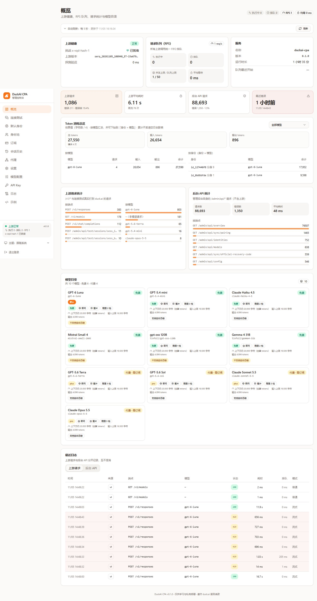
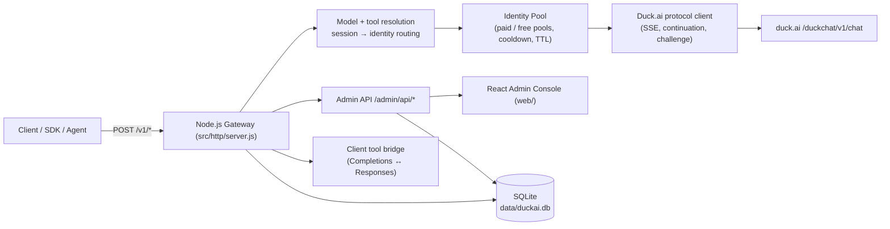

# 🦆 DuckAI CPA — OpenAI-Compatible Gateway & Admin Console for Duck.ai

**A self-hosted, production-hardened gateway that turns Duck.ai (DuckDuckGo AI Chat) into an OpenAI-compatible API, with a full React admin console, multi-identity pool, subscription management, tool calling, and SQLite storage.**

[](https://nodejs.org/)
[](https://react.dev/)
[](https://nodejs.org/api/sqlite.html)
[](https://www.docker.com/)
[](https://platform.openai.com/docs/api-reference)
[](LICENSE)
[](https://github.com/LandmineHQ/duckai-cpa/actions/workflows/build.yml)

*Use GPT-6, Claude, Mistral and open-source models from Duck.ai through one standard OpenAI interface — with streaming SSE, web search citations, image generation, multi-account routing and a self-hosted dashboard.*

**Repository:** <https://github.com/LandmineHQ/duckai-cpa> · **Actions:** <https://github.com/LandmineHQ/duckai-cpa/actions>



*Admin console overview: upstream health, queue/RPS, usage, model catalog, request logs and identity routing.*

[Features](#-key-features) • [Models](#-supported-models) • [Quick Start](#-quick-start) • [Client Integrations](#-client-integrations) • [Architecture](#-architecture) • [Configuration](#-configuration) • [Security](#-security--reliability)

---

## 📖 Overview

**DuckAI CPA** is a reverse-engineered bridge between **DuckDuckGo AI Chat (`duck.ai`)** and any OpenAI-compatible client, SDK or agent framework. Unlike browser-automation proxies, it speaks Duck.ai's native HTTP/SSE protocol directly from Node.js, including the rolling `X-VQD-Hash-1` anti-bot challenge, continuation frames for tool approvals, and durable streams.

It ships with a complete self-hosted control plane: identity pool management, subscription login (including refresh-token auto-renewal), two-pool model routing, quota cooldowns, session history, request logs, token usage statistics, prompt generation, model configuration and a connection-test playground.

---

## ✨ Key Features

### API surface

- **OpenAI-compatible endpoints**: `/v1/chat/completions` (stream + non-stream), `/v1/responses`, `/v1/images/generations`, `/v1/models`, `/v1/compact`.
- **Native SSE streaming** with `delta.content`, `reasoning_content`, url citations, generated images and usage chunks.
- **Responses API** with official event sequence (`response.created` → deltas → `response.completed`).
- **Web search** as `tools:[{"type":"web_search"}]`: citation markers are cleaned, `annotations[].url_citation` and `sources[]` are returned.
- **Image generation** via `GenerateImage` (OpenAI Images format + chat `message.images` data-URI extension; JPEG/PNG auto-detected).
- **Image context across turns**: replayed `image_generation_call` / `image_url` inputs are sent upstream as real image parts (JPEG automatically converted to PNG ≤512px), so follow-up prompts like “modify the previous image” keep visual context instead of degrading to text.
- **Client tool bridge**: OpenAI `tools[].function` is accepted on both Chat Completions and Responses, auto-normalized between protocols, and returned as native `tool_calls` / `function_call` items. File tools run **client-side** (Codex/DSH); the gateway never executes them.
- **Automatic PDF context spill**: when the text input exceeds duck.ai's 20k-character limit, older turns are rendered into two PDFs — `client-tools.pdf` (client tool protocol) and `conversation-context.pdf` (max 15 pages, 250 lines/page, images embedded) — and attached as `file` parts. The context PDF is persisted per session and reused across turns; manual `/v1/compact` also creates a new context PDF. This bypasses the duck.ai text char limit, not the model token window.
- **Server-side sessions**: Responses `previous_response_id` chaining is supported (the gateway stores canonical conversation + exact upstream prefix); Chat Completions can opt into server sessions with `X-Session-Id` + `X-Conversation-Mode: server` (or `X-Conversation-Delta: true` for delta-only messages). Historical prefix is reused byte-for-byte so image compression and tool protocol don't change earlier turns.

### Identity & routing

- **Multi-identity pool**: each identity has its own `journeyId`, device fingerprint, durable-stream keys and RSA key pair; per-identity rate limits and queues.
- **Two-pool routing**: paid models route to subscribed identities, free models to free identities; a session binds once and only rebinds when it crosses pools.
- **Quota cooldown**: when an identity hits Duck.ai's daily/entity quota (`ERR_USER_LIMIT`), it is temporarily disabled using the upstream reset time; existing sessions stay bound until the next request needs them (lazy rebinding).
- **Binding TTL cache**: session→identity bindings expire automatically after a configurable number of idle days.
- **Opt-in approximate location**: disabled by default (`canUseApproxLocation:false`); when enabled, LocationPrompt approvals are auto-granted.

### Subscriptions

- **Login capture** from a logged-in browser (bookmarklet/console script → same-origin token → admin console).
- **Automatic refresh**: stores the HttpOnly `ddg_auth_refresh_token` cookie and renews access tokens every 5 minutes before expiry; identities bound to a subscription are synced automatically.
- **Identity deletion guard**: an identity bound to a subscription must be unbound first (`409 identity_has_subscription`).

### Operations

- **SQLite storage** (`data/duckai.db`, WAL) for identities, bindings, subscriptions, logs, usage events, session history, connection-test sessions, compaction summaries and stats. No JSON snapshots (only `config.json`, `identity.json`, `pairing.json` remain).
- **Admin console** (React + Tailwind + Radix) with overview, live playground, identity pool, subscriptions, session history, logs, proxy, settings, model config, API keys and examples.
- **Session history** saved to SQLite with tool calls, generated images, reasoning, sources and 30-day retention.
- **Observability**: tool prompt-injection metadata (full protocol + injected first user) is stored per history entry; upstream logs expose tool names/injection flags; a local debug endpoint shows the redacted upstream messages actually sent to duck.ai.
- **Structured logs** with session key, identity and request id for traceability.
- **Optional HTTP/SOCKS proxy** for all upstream requests.
- **Docker & docker-compose** deployment.

---

## 🤖 Supported Models

Model IDs are resolved dynamically; aliases (e.g. `gpt-6`, `duck`) are accepted. Paid models require a subscription-bound identity.

| Duck.ai Model | Model IDs / Aliases | Provider | Tier |
|---|---|---|---|
| **GPT-6 Luna** | `gpt-6-luna`, `gpt-6`, `luna`, `default` | OpenAI | Free |
| **GPT-5.4 mini** | `gpt-5.4-mini`, `gpt-4o-mini` | OpenAI | Free |
| **Claude Haiku 4.5** | `claude-haiku-4-5`, `claude-haiku-4.5`, `claude` | Anthropic | Free |
| **Mistral Small 4** | `mistral-small-2603`, `mistral` | Mistral AI | Free |
| **gpt-oss 120B** | `tinfoil/gpt-oss-120b`, `oss-120b` | Tinfoil | Free |
| **Gemma 4 31B** | `tinfoil/gemma4-31b`, `gemma` | Google | Free |
| **GPT-5.6 Terra** | `gpt-5.6-terra` | OpenAI | Paid |
| **GPT-5.6 Sol** | `gpt-5.6-sol` | OpenAI | Paid |
| **Claude Sonnet 5.5** | `claude-sonnet-5-5` | Anthropic | Paid |
| **Claude Opus 5.5** | `claude-opus-5-5` | Anthropic | Paid |

---

## 🚀 Quick Start

### Requirements

- **Node.js 24+** (uses the built-in `node:sqlite`; experimental warning is expected)
- Optional: Docker / Docker Compose

### Option A — Local (recommended)

```bash
git clone https://github.com/LandmineHQ/duckai-cpa.git duckai-cpa
cd duckai-cpa

npm install
npm run build:web       # build the admin console into web/
npm start               # gateway on http://127.0.0.1:8787
```

First start creates `data/config.json` and prints an **admin token** and a default **API key** once:

- Admin console: <http://127.0.0.1:8787/admin>
- Health check: `GET /healthz`
- API landing page: <http://127.0.0.1:8787/>

> `data/` contains secrets (tokens, identity keys, pairing codes). Keep file mode `0600`, never commit it.

### Option C — Prebuilt image from GHCR

The repository has two workflows:

- `.github/workflows/build.yml` runs on every push: builds the admin console, trims production dependencies and uploads a `duckai-cpa-release` artifact (retained 30 days). Its run id is shown in the run summary.
- `.github/workflows/docker.yml` is **manual only**: provide a version tag and the successful build run id, and it downloads that artifact, builds the runtime image and pushes it to GHCR (multi-arch `linux/amd64` + `linux/arm64`).

```text
Actions → build (latest successful run) → copy run id
Actions → docker → Run workflow
  version: v0.1.0
  run_id:  <build run id>
```

Pull/run the published image:

```bash
# image built by the manual docker workflow
docker pull ghcr.io/landminehq/duckai-cpa:v0.1.0

docker run -d --name duckai-cpa -p 8787:8787 \
  -v "$PWD/data:/app/data" \
  -e DUCKAI_CPA_ADMIN_TOKEN=replace-with-a-strong-token \
  ghcr.io/landminehq/duckai-cpa:v0.1.0
```

The workflows use the repository `GITHUB_TOKEN` with `packages: write`; no extra secrets are required. The release image copies the artifact without running `npm install`, and removes npm/corepack from the final stage.

The manual `version` input follows Docker tag rules: English letters, digits, `.`, `_` and `-` are supported, for example `beta.0.0.1`, `v1.0.0-beta.1` or `v0.1.0`. Non-ASCII names are not valid Docker tags. This workflow version is separate from the npm `package.json` version (npm requires semver, for example `0.0.1-beta.0`).

Application version is not hardcoded in the frontend: the backend reads `package.json` (falling back to `0.1.0` only if unavailable), and the admin console renders `service.version` from `/admin/api/overview`. For published images the manual Docker workflow also sets `DUCKAI_CPA_VERSION` from the version input, so the image tag and the version shown in the dashboard stay in sync.

### Option B — Docker

```bash
npm install && npm run build:web     # the image ships the prebuilt web/ directory
docker build -t duckai-cpa .
docker run -d --name duckai-cpa -p 8787:8787 \
  -v "$PWD/data:/app/data" \
  -e DUCKAI_CPA_ADMIN_TOKEN=replace-with-a-strong-token \
  duckai-cpa
```

Or with Compose:

```bash
docker compose up -d --build
docker compose logs -f
```

---

## 🛠️ Client Integrations

### OpenAI Python SDK

```python
from openai import OpenAI

client = OpenAI(base_url="http://127.0.0.1:8787/v1", api_key="sk-your-api-key")

for chunk in client.chat.completions.create(
    model="gpt-6-luna",
    messages=[{"role": "user", "content": "Explain SSE in one sentence."}],
    stream=True,
):
    print(chunk.choices[0].delta.content or "", end="", flush=True)
```

### OpenAI Node SDK

```js
import OpenAI from "openai";

const client = new OpenAI({ baseURL: "http://127.0.0.1:8787/v1", apiKey: "sk-your-api-key" });
const res = await client.chat.completions.create({
  model: "claude-haiku-4-5",
  messages: [{ role: "user", content: "Hello!" }]
});
console.log(res.choices[0].message.content);
```

### cURL

```bash
curl -N http://127.0.0.1:8787/v1/chat/completions \
  -H "Authorization: Bearer sk-your-api-key" \
  -H "Content-Type: application/json" \
  -H "X-Session-Id: my-session-1" \
  -d '{
    "model": "gpt-6-luna",
    "stream": true,
    "messages": [{"role": "user", "content": "今天天气怎么样？"}]
  }'
```

### Desktop clients (Chatbox / Cherry Studio / NextChat / Open WebUI / Cursor)

| Field | Value |
|---|---|
| Provider | OpenAI |
| Base URL | `http://127.0.0.1:8787/v1` |
| API Key | your gateway key (`/admin → API Key`) |
| Model | any ID from the table above |

> Send `X-Session-Id` (or `session_id` / `conversation_id`) to keep a stable Duck.ai conversation per client session; otherwise the gateway derives one automatically.

---

### Client tools (Codex / DSH file tools)

Both protocols are auto-normalized — no manual allowlist needed:

```json
// /v1/chat/completions shape
{"tools":[{"type":"function","function":{"name":"read_file","description":"Read a file","parameters":{"type":"object","properties":{"path":{"type":"string"}},"required":["path"]}}}]}
// /v1/responses shape
{"tools":[{"type":"function","name":"read_file","description":"Read a file","parameters":{"type":"object","properties":{"path":{"type":"string"}},"required":["path"]}}]}
```

- `client` mode only: the model asks, **Codex/DSH executes locally**, and the result is sent back as `role:"tool"` (chat) or `function_call_output` (responses);
- Streaming returns `delta.tool_calls` / `response.function_call_arguments.*` events;
- **Stable prefix (v2.45)**: the tool protocol is attached to the **first** user message, so all historical messages stay byte-identical across turns and upstream prefix/prompt caches can be reused; do not move it to the last user message.
- Disable with **Settings → Tools → 客户端工具** (`tools.clientFunctionCalling.enabled`); no MCP/auto execution exists.

## 📐 Architecture



- **Node.js native http**: no Express; small dependency surface (`jsdom`, `undici`, `socks`, and pure-JS `jpeg-js`/`pngjs` for image conversion).
- **Challenge solver**: `X-VQD-Hash-1` rolling challenges executed via jsdom with browser-shaped stacks/signals.
- **SSE normalization**: strict protocol mode; unknown frames abort the request instead of silently degrading.
- **Continuation support**: tool approvals (web-search / image generation / approximate location) are resumed automatically with browser-identical payloads.

---

## 🔐 Subscriptions & Accounts

Duck.ai Pro features (paid models, higher quotas) require a signed-in Duck.ai session:

1. Open **Subscriptions** in the admin console.
2. Use the bookmarklet/console script on a logged-in `duck.ai` tab to capture the access token.
3. Optionally paste the `ddg_auth_refresh_token` cookie value to enable **automatic renewal**.
4. Bind the subscription to one or more identities; paid models then route to those identities.

The gateway never exposes full tokens through the API (only masked metadata) and stores them in SQLite / `data/identity.json` with restrictive permissions.

---

## ⚙️ Configuration

Configuration lives in `data/config.json` and can be edited from the admin console; environment variables override the basics:

| Variable | Default | Description |
|---|---|---|
| `DUCKAI_CPA_HOST` | `127.0.0.1` | Bind host (`0.0.0.0` in Docker) |
| `DUCKAI_CPA_PORT` | `8787` | HTTP port |
| `DUCKAI_CPA_ADMIN_TOKEN` | generated | Admin console/API token |
| `DUCKAI_CPA_DATA_DIR` | `data` | Runtime data directory |
| `DUCKAI_CPA_CONFIG_PATH` | `data/config.json` | Config file path |

Frequently used settings:

| Path | Default | Description |
|---|---|---|
| `duck.defaultModel` | `gpt-6-luna` | Default model |
| `duck.allowPaidModels` | `false` | Allow paid models |
| `duck.timeoutMs` | `120000` | Upstream timeout |
| `upstream.rps` / `maxConcurrent` | `1` / `1` | Global upstream rate limit |
| `pool.bindingTtlDays` | `7` | Session binding idle TTL (0 = forever) |
| `pool.quotaCooldownMinutes` | `1440` | Quota cooldown fallback |
| `tools.webSearch` / `imageGeneration` | `true` | Built-in tools |
| `tools.location` | `false` | Approximate location (user-location) |
| `tools.clientFunctionCalling.enabled` | `true` | Client tool bridge (Codex/DSH file tools) |
| `responses.enabled` / `retentionDays` | `true` / `7` | Responses `previous_response_id` chaining |
| `conversations.mode` | `stateless` | Chat Completions server sessions (`stateless` / `auto` / `server`) |
| `history.retentionDays` | `30` | Session history retention |
| `prompts.source` | `duckai` | Prompt generator source (`duckai`/`custom`/`none`) |

---

## 📚 API Surface

| Method | Path | Description |
|---|---|---|
| `GET` | `/v1/models` | Model catalog with context limits and capabilities |
| `POST` | `/v1/chat/completions` | Chat completions (stream / tools / images / reasoning) |
| `POST` | `/v1/responses` | OpenAI Responses API (stream + non-stream) |
| `POST` | `/v1/images/generations` | Image generation (`b64_json` / `url`) |
| `POST` | `/v1/compact` | Server-side conversation compaction |
| `GET` | `/healthz` | Health/upstream status |
| `*` | `/admin/api/*` | Admin API (token protected) |

Full contracts: [`docs/API.md`](docs/API.md), [`docs/ADMIN_API_V2.md`](docs/ADMIN_API_V2.md).

---

## 🛡️ Security & Reliability

- **Anti-bot challenge**: rolling `X-VQD-Hash-1` challenges are solved headlessly; strict protocol mode detects contract violations early.
- **Identity isolation**: every pooled identity has independent journey id, fingerprint, device id, durable-stream keys and per-identity queues; retries never silently hop identities.
- **Lazy rebinding**: cooling or quota-exhausted identities stop receiving new sessions, but existing bindings are only moved when a request actually arrives.
- **Bounded upstream calls**: global RPS/concurrency limits, queue-full/queue-timeout errors with `Retry-After`, and per-identity rate-limit cooldowns.
- **Secret handling**: admin token, API keys and subscription tokens are never printed in full; logs redact tokens; `data/` is gitignored and 0600.
- **Safe deletion**: `id_default` is protected, identity-with-subscription requires unbinding, and sync device deletion requires explicit confirmation.
- **Strict input validation**: malformed upstream frames, unknown tool types and unsupported roles return structured 4xx/5xx instead of degrading silently.

---

## 🧪 Development & Verification

```bash
npm run dev        # gateway with --watch
npm run dev:web    # Vite dev server for the admin console
npm run build:web  # build web/
npm test           # full test suite (node:test, sequential)
npm run smoke      # mock-based smoke test

node scripts/build-check.mjs   # build invariants
node scripts/page-check.mjs --admin-token <token> --api-key <key>   # live gateway checks
```

Test configuration: `tests/helpers/test-server.js` (`withServer`, `makeConfig`), `tests/helpers/mock-duck.js` (scripted DuckClient). All tests run with `--test-isolation=none --test-concurrency=1`.

All tests run **fully offline**: `tests/helpers/no-external-network.js` blocks any non-local `fetch` (duck.ai, duckduckgo.com, …) and tests inject mock upstream responses via `fetchImpl` options instead of touching the real network.

---

## 📁 Project Layout

```
src/duck/          duck.ai protocol: challenge, SSE, identity pool, sync, pairing, proxy
src/openai/        OpenAI compatibility: chat, responses, images, tools, compaction
src/admin/         admin API: routes, sessions, subscriptions, pairing, sync devices
src/http/          HTTP server, auth, CORS, SSE writer
webapp/src/        React admin console source
web/               built console (generated by npm run build:web; not committed)
tests/             node:test suites + mock DuckClient/Sync helpers
scripts/           build/page checks, smoke, live and proxy probes
docs/              protocol/API/acceptance documentation
data/              runtime data + SQLite (gitignored; contains secrets)
```

---

## 📄 Documentation Index

| Document | Content |
|---|---|
| [`docs/API.md`](docs/API.md) | OpenAI-compatible API behavior |
| [`docs/ADMIN_API_V2.md`](docs/ADMIN_API_V2.md) | Admin API contracts |
| [`docs/PROTOCOL.md`](docs/PROTOCOL.md) / [`docs/PROTOCOL-ERRORS.md`](docs/PROTOCOL-ERRORS.md) | Duck.ai protocol and error mapping |
| [`docs/ACCEPTANCE.md`](docs/ACCEPTANCE.md) | Version-by-version acceptance records |
| [`docs/CLIENT-TOOLS-RESEARCH.md`](docs/CLIENT-TOOLS-RESEARCH.md) | Duck.ai experimental client-tools research |
| [`AGENTS.md`](AGENTS.md) | Project guide for contributors/agents |

---

## ⚠️ Disclaimer

This project is an independent reverse-engineered interoperability layer for **educational, research and personal self-hosting purposes**. It is **not affiliated with, endorsed by, or associated with DuckDuckGo**. Respect Duck.ai's terms of service and local laws; do not use it to abuse upstream services. Upstream APIs and anti-bot mechanisms may change at any time.

## 📝 License

MIT — see [LICENSE](LICENSE).
